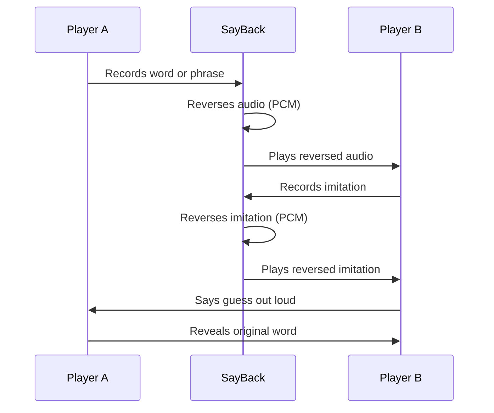

# 🎙️ SayBack

**Hear it backwards. Say it back.**

SayBack is a two-player party game that runs entirely in your browser. Player A records a word or phrase, the app reverses the audio, Player B imitates the reversed sound, and the app reverses that imitation — revealing something that (hopefully) resembles the original. No accounts, no uploads, no AI. Just two people, one phone, and a lot of laughs.

---

## Demo

> 📸 Screenshots and a live demo link will be added here once the app is deployed.
>
> To try it now, run it locally — see [Getting Started](#getting-started) below.

---

## How to Play

Two players share one device.

1. **Player A records** — Think of any word or short phrase. Tap *Start Recording*, say it, then tap *Stop*.
2. **Listen to the reversal** — SayBack reverses the audio sample-by-sample and plays it back to Player B.
3. **Player B imitates** — Player B listens as many times as needed, then records their best imitation of the reversed sound.
4. **Hear the result** — SayBack reverses Player B's imitation and plays it back.
5. **Guess and reveal** — Player B says their guess out loud. Player A reveals the original word verbally. Compare and play again.



The game works best with short, punchy words. Longer phrases get stranger — which is half the fun.

---

## Features

All features listed here are implemented and verified in the source code.

- **PCM audio reversal** — Recordings are reversed at the sample level using the Web Audio API, not by adjusting playback speed. Every channel is reversed independently, preserving stereo recordings.
- **Two-player imitation flow** — A validated state machine drives the full round: record → reverse → listen → imitate → reverse → guess → reveal.
- **Unlimited replays** — Players can replay the reversed audio as many times as they need before recording their imitation.
- **Live recording timer** — A running timer and animated waveform display are shown while recording is active.
- **Microphone permission handling** — The app requests microphone access only on a user gesture and surfaces clear, actionable error messages for denied permissions, missing devices, and unsupported browsers.
- **Overlap prevention** — The engine prevents double-recording and stops any active playback before starting a new one.
- **Resource cleanup** — Microphone tracks are stopped immediately after each recording ends. The `AudioContext` is closed when the player exits the game.
- **Retry support** — Players can retry a recording mid-session without restarting the round.
- **Progressive Web App** — Includes a Web App Manifest and a service worker that caches the app shell for offline use. Installable on Android and iOS home screens.
- **Mobile-first layout** — Designed for portrait orientation on phones, with safe-area insets for notched devices and touch-optimised tap targets.
- **Reduced motion support** — Animations are suppressed when the user's OS has reduced motion enabled.
- **No server, no data collection** — All audio stays in memory on the device. Nothing is transmitted or stored persistently.

---

## Technology Stack

| Technology | Role |
|---|---|
| [Next.js 15](https://nextjs.org/) | React framework, file-based routing, production build |
| [React 19](https://react.dev/) | UI component model and state management |
| [TypeScript 5](https://www.typescriptlang.org/) | Static typing across the entire codebase |
| [Tailwind CSS 4](https://tailwindcss.com/) | Utility-first styling |
| [Web Audio API](https://developer.mozilla.org/en-US/docs/Web/API/Web_Audio_API) | Audio context, decoding, PCM buffer manipulation, playback |
| [MediaRecorder API](https://developer.mozilla.org/en-US/docs/Web/API/MediaRecorder) | Microphone capture with automatic format detection |
| [class-variance-authority](https://cva.style/) | Type-safe button variant system |
| [Radix UI Slot](https://www.radix-ui.com/primitives/docs/utilities/slot) | Polymorphic button composition |
| [lucide-react](https://lucide.dev/) | Icon set |
| [idb](https://github.com/jakearchibald/idb) | IndexedDB wrapper (settings persistence) |
| [Vitest](https://vitest.dev/) + [jsdom](https://github.com/jsdom/jsdom) | Unit testing with a mocked Web Audio environment |
| Service Worker | App-shell caching for offline support |

---

## Getting Started

### Prerequisites

- **Node.js** ≥ 18 (developed and tested on v24)
- **npm** ≥ 9

### Install and run

```bash
git clone https://github.com/MichaelMansour256/SayBack.git
cd SayBack
npm install
npm run dev
```

Open [http://localhost:3000](http://localhost:3000) in your browser.

### Available scripts

| Command | Description |
|---|---|
| `npm run dev` | Start the development server |
| `npm run build` | Create a production build |
| `npm start` | Serve the production build |
| `npm test` | Run the test suite once |
| `npm run test:watch` | Run tests in watch mode |
| `npm run type-check` | TypeScript type check without emitting |
| `npm run lint` | ESLint via Next.js |

### Environment variables

No environment variables are required. The app runs entirely client-side with no external services.

### Testing on a phone

The browser's microphone API requires a **secure context** (HTTPS or `localhost`). Options:

- **Localhost** — works directly on the same machine.
- **Vercel** — deploy with `vercel` or via the Vercel dashboard; HTTPS is provided automatically.
- **Tunnel** — expose localhost over HTTPS using [ngrok](https://ngrok.com/) or [cloudflared](https://developers.cloudflare.com/cloudflare-one/connections/connect-networks/), then open the HTTPS URL on your phone and grant microphone permission when prompted.

---

## Project Structure

```
SayBack/
├── app/
│   ├── page.tsx              # Home route → HomeScreen
│   ├── game/
│   │   └── page.tsx          # Game route → state-driven screen router
│   ├── layout.tsx            # Root layout, metadata, PWA meta tags
│   └── globals.css           # Global styles, CSS custom properties, animations
├── components/
│   ├── screens/
│   │   ├── home.tsx          # Landing screen with How to Play
│   │   ├── create-round.tsx  # Player A recording screen
│   │   ├── listen-imitate.tsx# Reversed playback + Player B imitation screen
│   │   ├── guess.tsx         # Result playback + reveal trigger
│   │   ├── reveal.tsx        # Post-reveal playback and next-round controls
│   │   └── error.tsx         # Error display with retry / home actions
│   ├── ui/
│   │   ├── button.tsx        # CVA-based button with game-specific variants
│   │   ├── card.tsx          # Card layout primitives
│   │   └── waveform.tsx      # Animated waveform visualiser (rAF-driven)
│   ├── game-provider.tsx     # React context: wires machine + engine to screens
│   └── sw-registration.tsx   # Service worker registration (client component)
├── lib/
│   ├── audio.ts              # AudioEngine class + pure PCM reversal functions
│   ├── game.ts               # Validated round state machine
│   ├── storage.ts            # IndexedDB wrapper (settings only, no audio)
│   ├── utils.ts              # cn() utility (clsx + tailwind-merge)
│   └── sayback.test.ts       # Unit tests
├── public/
│   ├── sw.js                 # Service worker (app-shell cache strategy)
│   ├── manifest.json         # PWA manifest
│   └── icons/                # SVG icons (favicon, Apple touch, PWA)
├── vitest.config.ts          # Vitest configuration
├── vitest.setup.ts           # jsdom mocks for AudioContext, AudioBuffer, MediaRecorder
├── next.config.ts
├── tailwind.config.ts
└── tsconfig.json
```

---

## How It Works

### Audio capture

When Player A taps *Start Recording*, the app calls `navigator.mediaDevices.getUserMedia` to obtain a `MediaStream`. A `MediaRecorder` captures the stream into `Blob` chunks. The supported MIME type is detected at runtime from a priority list (`audio/webm;codecs=opus`, `audio/webm`, `audio/ogg;codecs=opus`, `audio/ogg`, `audio/mp4`, `audio/wav`) so the app works across Chrome, Firefox, and Safari without hardcoding a format.

### PCM reversal

When recording stops, the `Blob` is decoded into an `AudioBuffer` via `AudioContext.decodeAudioData`. The reversal is then performed in pure TypeScript:

```ts
// Each channel's Float32Array is reversed independently.
function reverseChannel(channel: Float32Array): Float32Array {
  const reversed = new Float32Array(channel.length);
  for (let i = 0; i < channel.length; i++) {
    reversed[i] = channel[channel.length - 1 - i];
  }
  return reversed;
}
```

This operates on raw PCM samples, not on playback rate or pitch. The result is a new `AudioBuffer` with the same duration, sample rate, and channel count as the original. Reversing twice exactly restores the original signal (verified by the test suite).

### State machine

The game flow is managed by a hand-written state machine in `lib/game.ts`. Every transition is validated against an explicit allowlist; invalid transitions throw. The machine holds only clip IDs — the actual `AudioBuffer` objects live in a `Map` inside `GameProvider` and are never written to disk.

```
idle
 └─▶ requesting-microphone
      └─▶ recording-original
           └─▶ processing-original
                └─▶ listening-to-reversed
                     └─▶ recording-imitation
                          └─▶ processing-imitation
                               └─▶ listening-to-reconstructed
                                    └─▶ guessing
                                         └─▶ revealed
                                              └─▶ idle (next round)
```

Any state can transition to `error`, and `error` can return to `idle` or `requesting-microphone`.

### Playback

Playback uses `AudioBufferSourceNode`. The engine stops any active source before starting a new one, so playback never overlaps. The `AudioContext` is created lazily on the first user gesture and reused for the session lifetime.

---

## Configuration and Troubleshooting

**Microphone permission denied**
The browser will show a permission prompt the first time. If it was previously denied, go to your browser's site settings and re-enable microphone access for the page, then reload.

**No audio plays back**
Some browsers suspend the `AudioContext` until a user gesture. Tap any button to resume. If the problem persists, check that your device volume is not muted and that no other app has exclusive microphone access.

**"MediaRecorder is not supported"**
SayBack requires a browser that supports the MediaRecorder API. Use a recent version of Chrome, Edge, Firefox, or Safari (15.4+). Very old browsers or some in-app WebViews may not support it.

**Microphone indicator stays on after recording**
The engine calls `track.stop()` on all `MediaStream` tracks as soon as `stopRecording()` completes. If the indicator persists, check whether another tab or app is holding the microphone.

**`npm install` fails**
Ensure you are running Node.js 18 or later. The `postinstall` script creates `public/icons/` if it does not exist; this is harmless and requires no manual action.

**Development server shows a blank page**
Run `npm run type-check` and `npm run lint` to surface any compilation errors before starting the dev server.

---

## Contributing

1. Fork the repository on GitHub.
2. Create a focused branch: `git checkout -b your-feature-name`
3. Make your change. Keep commits small and descriptive.
4. Run the checks:
   ```bash
   npm run type-check
   npm run lint
   npm test
   npm run build
   ```
5. Open a pull request against `main` with a clear description of what changed and why.

All four checks must pass before a PR can be merged.

---

## Roadmap

These are ideas, not commitments. Nothing here is implemented yet.

- [ ] Animated countdown before recording starts
- [ ] Haptic feedback on mobile during recording
- [ ] Share a round result as an audio clip
- [ ] Round history (local, on-device only)

---

## License

No license file has been found in this repository. All rights are reserved by the author unless a license is added. If you want to use, modify, or distribute this code, please contact the author first.

---

## Author

Built by [Michael Mansour](https://github.com/MichaelMansour256).
